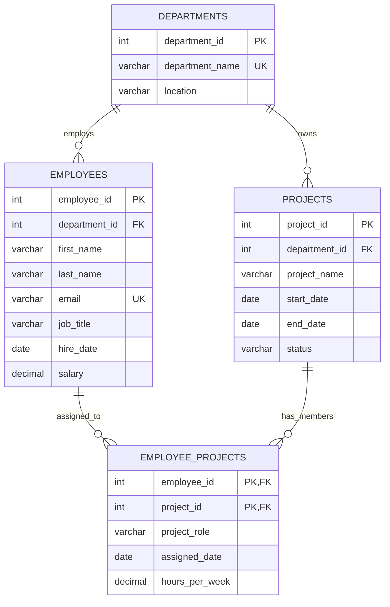

# Employee Management System ER Diagram

`EMPLOYEE_PROJECTS` is the junction table for the many-to-many relationship between employees and projects. Its composite primary key prevents an employee from being assigned to the same project more than once.
