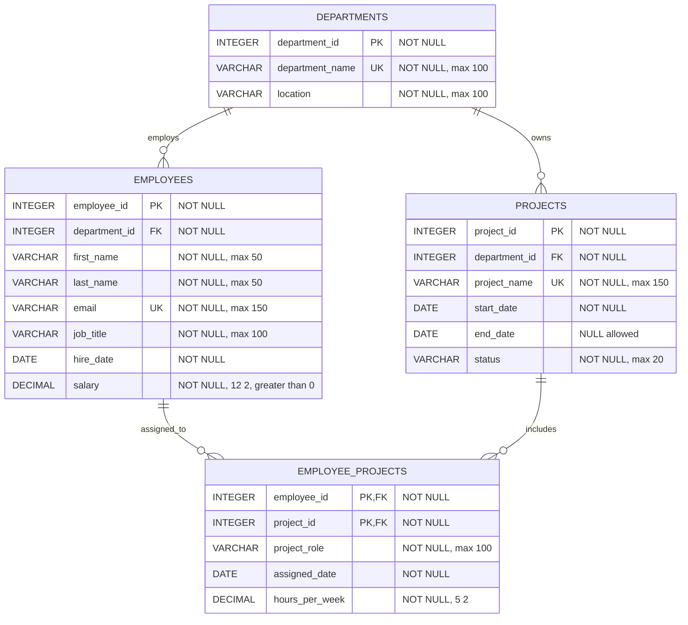

# Employee Management System ER Diagram

`EMPLOYEE_PROJECTS` resolves the many-to-many relationship between employees and projects. Its composite primary key prevents an employee from being assigned to the same project more than once.

## Rules shown in the schema

- **Departments:** `department_id` is the primary key; `department_name` is unique.
- **Employees:** `employee_id` is the primary key; `email` is unique; `department_id` references `DEPARTMENTS`; `salary` must be greater than zero.
- **Projects:** `project_id` is the primary key; `project_name` is unique; `department_id` references `DEPARTMENTS`; `end_date` must be on or after `start_date` when provided; `status` must be `Planned`, `Active`, `On Hold`, or `Completed`.
- **Employee_Projects:** `(employee_id, project_id)` is the composite primary key; both columns reference their parent tables; `hours_per_week` must be greater than zero and at most 168.

All columns are `NOT NULL` unless marked `NULL allowed` in the diagram.
